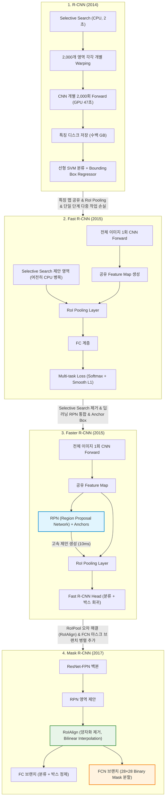

# [1주차 논문 스터디] R-CNN 시리즈 핵심 요약 및 계보 비교 종합 가이드

> **대상 논문**:
> 1. **R-CNN** (CVPR 2014): *Rich feature hierarchies for accurate object detection and semantic segmentation*
> 2. **Fast R-CNN** (ICCV 2015): *Fast R-CNN*
> 3. **Faster R-CNN** (NeurIPS 2015 / TPAMI 2017): *Faster R-CNN: Towards Real-Time Object Detection with Region Proposal Networks*
> 4. **Mask R-CNN** (ICCV 2017, Marr Prize): *Mask R-CNN*

---

## 1. R-CNN 4부작 발전 계보 한눈에 보기

딥러닝 기반 객체 검출(Object Detection)과 인스턴스 분할(Instance Segmentation)의 역사는 **"계산의 중복을 제거하고(Sharing Computation), 파이프라인을 하나의 신경망으로 결합(End-to-End Integration)하며, 픽셀 단위 정합을 완성(RoIAlign)"**해 가는 과정이었습니다.

---

## 2. 4대 모델 핵심 요소 비교표

| 비교 항목 | R-CNN (2014) | Fast R-CNN (2015) | Faster R-CNN (2015) | Mask R-CNN (2017) |
| :--- | :--- | :--- | :--- | :--- |
| **태스크 (Task)** | 바운딩 박스 검출 | 바운딩 박스 검출 | 바운딩 박스 검출 | 검출 + **인스턴스 분할** (+ 포즈 추정) |
| **영역 제안 (Region Proposal)** | Selective Search (CPU, 외장) | Selective Search (CPU, 외장) | **RPN (GPU, 신경망 내장)** | **RPN (FPN 특징 피라미드 연계)** |
| **CNN 연산 횟수** | 이미지 1장당 **약 2,000회** | 이미지 1장당 **단 1회** | 이미지 1장당 **단 1회** | 이미지 1장당 **단 1회** |
| **RoI 특징 추출** | Warping (227×227 리사이징) | **RoI Pooling** (양자화 맥스풀) | RoI Pooling (양자화 맥스풀) | **RoIAlign** (양자화 없는 쌍선형 보간) |
| **분류기 (Classifier)** | 선형 SVM (클래스별 독립) | **내장 Softmax** (단일 단계) | 내장 Softmax | 내장 Softmax |
| **경계 상자 회귀** | 별도 선형 릿지 회귀 ($L_2$) | **Smooth $L_1$** (다중 작업 손실) | Smooth $L_1$ (RPN + Fast R-CNN) | Smooth $L_1$ |
| **마스크 분할** | 미지원 (휴리스틱 부록 제외) | 미지원 | 미지원 | **FCN 마스크 헤드** (클래스별 바이너리) |
| **학습 방식** | 3단계 분리 (CNN $\rightarrow$ SVM $\rightarrow$ 회귀) | 1단계 통합 (Conv+FC 역전파) | 4단계 교대 학습 / 근사 결합 | 종단간 결합 학습 ($L_{cls}+L_{box}+L_{mask}$) |
| **디스크 캐싱** | 수백 GB 필수 (특징 저장) | **전혀 불필요** | **전혀 불필요** | **전혀 불필요** |
| **추론 속도 (VGG16 기준)** | **47초 / 장** | **0.22초 / 장** (SS 제외 시) | **0.20초 / 장 (5 fps, SS 포함!)** | **0.20초 / 장 (5 fps, 마스크 포함!)** |
| **대표 벤치마크** | VOC 2007: 58.5% mAP | VOC 2007: 66.9% mAP | VOC 2007: 73.2% mAP | COCO: 37.1% Mask AP / 41.3% Box AP |

---

## 3. 핵심 기술 혁신 상세 정리

### 1) 왜 R-CNN에서 Fast R-CNN으로 진화했는가?
- **문제점**: R-CNN은 2,000개의 제안 영역마다 각각 CNN을 독립적으로 통과시켰기 때문에 동일한 이미지 영역의 특징을 수천 번 중복 계산했습니다.
- **해결책 (RoI Pooling)**: 원본 이미지 전체를 CNN에 단 1번만 통과시켜 **1개의 커다란 합성곱 특징 맵**을 뽑은 뒤, 제안 영역들의 좌표만 비율에 맞춰 매핑하여 잘라내고(RoI Pooling), 이를 고정된 크기(예: $7 \times 7$)로 축약하여 FC 계층에 넘겼습니다.
- **해결책 (Multi-task Loss)**: 이전에는 따로따로 학습하던 분류기와 박스 회귀기를 **$L_{cls} + L_{loc}$** 단일 손실 함수로 합치고, 역전파를 RoI Pooling을 통해 합성곱 계층까지 흘려보내 **단일 단계(Single-stage) 종단간 미세조정**을 완성했습니다.

---

### 2) 왜 Fast R-CNN에서 Faster R-CNN으로 진화했는가?
- **문제점**: Fast R-CNN이 탐지 네트워크를 0.2초대로 극적으로 단축시켰으나, 정작 후보 영역을 생성하는 **Selective Search(CPU)**가 2초 이상 걸려 전체 시스템의 병목(90% 시간 소모)이 되었습니다.
- **해결책 (RPN & Anchors)**: 후보 영역 생성마저 딥러닝 모델 안으로 흡수했습니다. 공유 합성곱 계층 위에 $3 \times 3$ Conv를 얹은 **RPN(Region Proposal Network)**을 설계하고, 다양한 크기와 종횡비를 가진 기준 박스인 **앵커(Anchor)**를 도입하여 단 **10ms** 만에 정밀한 후보 영역을 추출했습니다. 이로써 외부 알고리즘 의존성을 완전히 탈피하고 진정한 실시간 객체 검출(5~17 fps)을 실현했습니다.

---

### 3) 왜 Faster R-CNN에서 Mask R-CNN으로 진화했는가?
- **문제점**:
  1. Faster R-CNN은 바운딩 박스 검출기일 뿐, 물체의 정밀한 외곽선(Mask)을 따는 인스턴스 세그멘테이션을 하지 못했습니다.
  2. RoIPool 계층이 부동소수점 좌표를 특징 맵 격자로 내림/반올림(양자화, $[x/16]$)하면서 생기는 위치 오차가 박스 분류에는 치명적이지 않았으나, 픽셀 단위 마스크 분할에서는 경계가 심하게 어긋나는 문제가 발생했습니다.
- **해결책 (RoIAlign)**: RoI 경계와 bin 분할에서 일체의 양자화를 없애고 부동소수점 좌표를 유지한 채, 각 bin 내부의 4개 지점에서 **쌍선형 보간법(Bilinear Interpolation)**을 적용해 정밀한 특징값을 추출함으로써 위치 오정렬을 완전히 해결했습니다.
- **해결책 (Decoupled FCN Branch)**: 분류/박스 회귀 브랜치 옆에 $28 \times 28$ 바이너리 마스크를 예측하는 작은 FCN 브랜치를 병렬로 붙이고, 클래스 간 경쟁을 배제하는 독립 시그모이드(Binary Cross-Entropy) 손실을 적용하여 최고 성능을 달성했습니다.

---

## 4. 필수 수식 총정리

### ① 경계 상자 회귀 타깃 공식 (R-CNN부터 Mask R-CNN까지 공통 사용)
제안 상자(또는 앵커) $P = (P_x, P_y, P_w, P_h)$와 정답 상자 $G = (G_x, G_y, G_w, G_h)$ 사이의 오프셋:

$$t_x = \frac{G_x - P_x}{P_w}, \quad t_y = \frac{G_y - P_y}{P_h}$$
$$t_w = \log\left(\frac{G_w}{P_w}\right), \quad t_h = \log\left(\frac{G_h}{P_h}\right)$$

예측값 $t = (t_x, t_y, t_w, t_h)$로부터 복원된 상자 $\hat{G}$:
$$\hat{G}_x = P_w t_x + P_x, \quad \hat{G}_y = P_h t_y + P_y$$
$$\hat{G}_w = P_w \exp(t_w), \quad \hat{G}_h = P_h \exp(t_h)$$

---

### ② Smooth $L_1$ 손실 함수 (Fast R-CNN 도입)
이상치(Outlier)에 민감한 $L_2$ 손실과 $0$에서 미분 불가능한 $L_1$ 손실의 장점을 결합:

$$\text{smooth}_{L_1}(x) = \begin{cases} 0.5 x^2 & \text{if } |x| < 1 \\ |x| - 0.5 & \text{otherwise} \end{cases}$$

---

### ③ Mask R-CNN 최종 다중 작업 손실 함수
$$L = L_{cls} + L_{box} + L_{mask}$$
- $L_{cls}$: 정답 클래스 $u$에 대한 교차 엔트로피 손실 ($-\log p_u$)
- $L_{box}$: 전경 클래스($u \ge 1$)에 대해서만 활성화되는 Smooth $L_1$ 위치 회귀 손실
- $L_{mask}$: 정답 클래스 $k$번째 마스크에 대해서만 계산되는 $m \times m$ 픽셀 단위 이진 교차 엔트로피 손실 (클래스 경쟁 제거)

---

## 5. 주차별 스터디 파일 안내

번역 및 상세 해설 문서는 원본 PDF와 동일한 폴더(`C:\study\논문\1주차\`)에 다음 순서로 정리되어 있습니다:

1. [`01_R-CNN_한글번역.md`](file:///c:/study/논문/1주차/01_R-CNN_한글번역.md) : 딥러닝 객체 검출의 태동, 지도 사전학습과 전이학습 패러다임
2. [`02_Fast_R-CNN_한글번역.md`](file:///c:/study/논문/1주차/02_Fast_R-CNN_한글번역.md) : RoI Pooling, 다중 작업 손실, 단일 단계 학습 혁신
3. [`03_Faster_R-CNN_한글번역.md`](file:///c:/study/논문/1주차/03_Faster_R-CNN_한글번역.md) : RPN과 앵커 메커니즘을 통한 완전한 종단간 실시간 검출
4. [`04_Mask_R-CNN_한글번역.md`](file:///c:/study/논문/1주차/04_Mask_R-CNN_한글번역.md) : RoIAlign과 병렬 마스크 분기를 통한 인스턴스 세그멘테이션 완성
