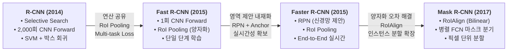

# [1페이지 요약] R-CNN 시리즈 4대 논문 핵심 요약 및 계보 정리

> **대상 논문**:
> 1. **R-CNN** (CVPR 2014): *Rich feature hierarchies for accurate object detection and semantic segmentation*
> 2. **Fast R-CNN** (ICCV 2015): *Fast R-CNN*
> 3. **Faster R-CNN** (NeurIPS 2015): *Faster R-CNN: Towards Real-Time Object Detection with Region Proposal Networks*
> 4. **Mask R-CNN** (ICCV 2017): *Mask R-CNN*

---

## 1. 발전 계보 한눈에 보기

---

## 2. 4대 모델 종합 비교표

| 비교 항목 | R-CNN (2014) | Fast R-CNN (2015) | Faster R-CNN (2015) | Mask R-CNN (2017) |
| :--- | :--- | :--- | :--- | :--- |
| **태스크 (Task)** | 바운딩 박스 검출 | 바운딩 박스 검출 | 바운딩 박스 검출 | 검출 + **인스턴스 분할 (Instance Seg.)** |
| **영역 제안 (Proposal)** | Selective Search (CPU, 외장) | Selective Search (CPU, 외장) | **RPN (GPU, 신경망 내장)** | **RPN (FPN 결합)** |
| **CNN 연산 횟수** | 이미지당 **약 2,000회** | 이미지당 **단 1회** (특징 공유) | 이미지당 **단 1회** (특징 공유) | 이미지당 **단 1회** (특징 공유) |
| **RoI 특징 추출** | Warping (227×227 왜곡) | **RoI Pooling** (정수 양자화) | RoI Pooling (정수 양자화) | **RoIAlign** (양자화 제거, 쌍선형 보간) |
| **분류기 (Classifier)** | 선형 SVM (클래스별 독립) | **내장 Softmax** | 내장 Softmax | 내장 Softmax |
| **박스 회귀 손실** | 별도 선형 릿지 회귀 ($L_2$) | **Smooth $L_1$** (Multi-task) | Smooth $L_1$ (RPN + Head) | Smooth $L_1$ |
| **마스크 분할 분기** | 미지원 | 미지원 | 미지원 | **FCN 마스크 헤드 (독립 Sigmoid)** |
| **학습 방식** | 3단계 분리 (CNN $\rightarrow$ SVM $\rightarrow$ 회귀) | 1단계 통합 (단일 다중작업 손실) | 4단계 교대 / 근사 종단간 학습 | 완전한 종단간 결합 학습 |
| **디스크 캐싱** | 수백 GB 필수 (특징값 저장) | **전혀 불필요** | **전혀 불필요** | **전혀 불필요** |
| **추론 속도 (VGG16 기준)** | **47초 / 장** (0.02 fps) | **2.3초 / 장** (0.4 fps, SS포함) | **0.2초 / 장 (5~17 fps)** | **0.2초 / 장 (5 fps, 마스크 포함)** |
| **핵심 한계점** | 연산 중복 심각, 저장공간 낭비 | 영역 제안(SS, 2초)이 전체 병목 | RoIPool 양자화로 서브픽셀 오차 | 2-stage 구조로 인한 1-stage 대비 속도 |

---

## 3. 논문별 핵심 내용 요약

### ① R-CNN (2014) — 딥러닝 객체 검출 패러다임 정립
- **핵심 아이디어**: 이미지 분류용 CNN(AlexNet)을 객체 검출(Detection)에 성공적으로 도입.
- **파이프라인**: 
  1. Selective Search로 이미지당 약 2,000개의 후보 영역(Region Proposals) 추출.
  2. 후보 영역을 고정 규격(227×227)으로 강제 크기 변환(Warping).
  3. 2,000개 영역 각각을 독립적으로 CNN에 통과시켜 4,096차원 특징 벡터 추출.
  4. 클래스별 선형 SVM 분류 및 Bounding-box Regression(선형 릿지) 적용.
- **한계**: 이미지 1장당 2,000번의 CNN Forward 연산 수행(장당 47초 소요), 특징 벡터 저장을 위해 수백 GB의 디스크 필요, 다단계 분리 학습으로 종단간 최적화 불가.

---

### ② Fast R-CNN (2015) — 연산 공유(RoI Pooling)와 단일 단계 학습
- **핵심 아이디어**: 전체 이미지를 CNN에 **단 1번만** 통과시켜 특징 맵을 공유하고, **RoI Pooling**으로 후보 영역의 특징을 일괄 추출.
- **파이프라인**:
  1. 원본 전체 이미지를 CNN에 통과시켜 1개의 대형 특징 맵(Feature Map) 생성.
  2. Selective Search로 찾은 제안 영역을 특징 맵 크기에 맞게 투영(Projection).
  3. **RoI Pooling**: 각 영역을 $7 \times 7$ 격자로 나누고 맥스 풀링하여 고정 크기 특징 벡터 생성.
  4. FC 계층을 거쳐 Softmax 분류기와 Smooth $L_1$ 위치 회귀기를 **다중 작업 손실(Multi-task Loss)**로 동시 학습.
- **성과 및 한계**: 학습/추론 속도를 획기적으로 개선하고 디스크 캐싱을 없앰. 그러나 후보 영역을 생성하는 외부 알고리즘(Selective Search, CPU)이 여전히 장당 ~2초를 소모하여 전체 시스템의 병목(90% 시간 점유)으로 남음.

---

### ③ Faster R-CNN (2015) — RPN을 통한 완전한 종단간 실시간 검출
- **핵심 아이디어**: 마지막 병목이던 영역 제안 단계마저 딥러닝 신경망 내부로 통합한 **RPN(Region Proposal Network)**과 **앵커 박스(Anchor Boxes)** 도입.
- **파이프라인**:
  1. 백본 CNN(VGG16 등)을 거쳐 공유 특징 맵 추출.
  2. **RPN**: $3 \times 3$ sliding window와 9개의 앵커(3 scales $\times$ 3 aspect ratios)를 이용해 단 10ms 만에 후보 영역과 전경/배경 점수 산출.
  3. 선별된 RoI를 공유 특징 맵에서 RoI Pooling으로 추출.
  4. Fast R-CNN Head가 최종 분류 및 경계 상자 세부 좌표 보정 수행.
- **성과 및 한계**: 외부 알고리즘 의존성을 100% 제거하고 **진정한 실시간 2-stage 검출(5~17 FPS)** 실현. 단, RoIPool의 격자 내림/반올림(양자화)으로 인한 위치 오차와 Bounding Box 검출에 국한된 한계가 존재.

---

### ④ Mask R-CNN (2017) — RoIAlign과 픽셀 단위 인스턴스 분할
- **핵심 아이디어**: Faster R-CNN을 확장하여 픽셀 단위 마스크를 예측하는 **병렬 FCN 마스크 분기** 추가 + 위치 정합성을 완벽 복원하는 **RoIAlign** 제안.
- **핵심 혁신 요소**:
  1. **RoIAlign**: RoI 경계와 bin 분할 시 정수 양자화($[x/16]$)를 전면 배제하고, 부동소수점 좌표에서 **쌍선형 보간법(Bilinear Interpolation)**을 적용해 4개 샘플링 지점의 특징을 정확하게 집계.
  2. **Decoupled FCN Branch**: 기존 분류/박스 회귀 헤드 옆에 작은 FCN(Fully Convolutional Network) 마스크 헤드를 병렬 배치. 클래스 간 경쟁(Softmax)을 없애고 **클래스별 독립 이진 마스크(Sigmoid + Binary Cross-Entropy)**를 적용.
- **성과**: 인스턴스 분할(Instance Segmentation) 분야 최고 성능(SOTA) 달성, 박스 검출 성능도 함께 상승, 동일 프레임워크로 사람 자세 추정(Keypoint Detection)까지 완벽 지원.

---

## 4. 핵심 수식 정리

### 1) 경계 상자 오프셋 타깃 ($P$: 제안 박스, $G$: 정답 박스)
$$t_x = \frac{G_x - P_x}{P_w}, \quad t_y = \frac{G_y - P_y}{P_h}$$
$$t_w = \log\left(\frac{G_w}{P_w}\right), \quad t_h = \log\left(\frac{G_h}{P_h}\right)$$

### 2) Smooth $L_1$ 손실 함수
$$\text{smooth}_{L_1}(x) = \begin{cases} 0.5 x^2 & \text{if } |x| < 1 \\ |x| - 0.5 & \text{otherwise} \end{cases}$$

### 3) Mask R-CNN 최종 다중 작업 손실 함수
$$L = L_{cls} + L_{box} + L_{mask}$$
- $L_{cls}$: 정답 클래스에 대한 Cross-Entropy 손실
- $L_{box}$: 전경 클래스에 대한 Smooth $L_1$ 박스 회귀 손실
- $L_{mask}$: 정답 클래스에 대해서만 계산되는 $m \times m$ 픽셀 단위 Binary Cross-Entropy 손실

---

## 5. 핵심 요약 문장
> **R-CNN**(2,000회 연산 중복) $\rightarrow$ **Fast R-CNN**(1회 공유 연산, RoIPool) $\rightarrow$ **Faster R-CNN**(RPN을 통한 실시간화) $\rightarrow$ **Mask R-CNN**(RoIAlign & 인스턴스 분할 확장)으로 진화하며 현대 2-stage 비전 아키텍처의 표준을 완성했습니다.
