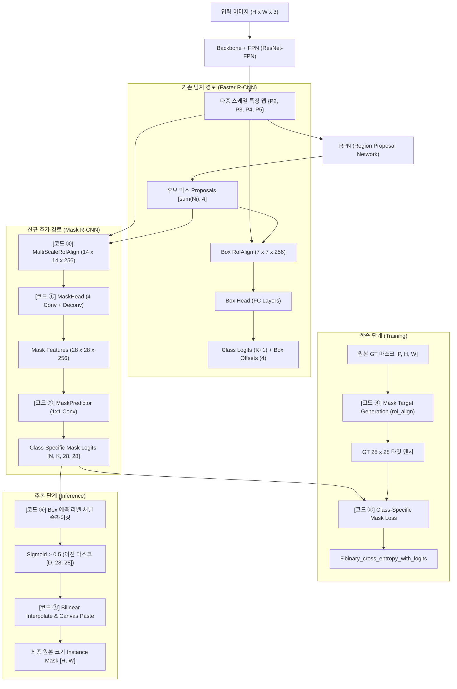

# Mask R-CNN 핵심 구현 코드 심층 해설서 (Code Walkthrough)

> **발표자료 출처**: `Mask_RCNN_Balanced_Revision_21slides.pptx` (김상현 님)  
> **핵심 주제**: Faster R-CNN 기반 위에 Mask Branch를 병렬 증설하고, RoIAlign · Deconvolution · Decoupled Sigmoid Loss · Image-space Canvas Paste까지 연결하는 파이토치(PyTorch) 구현 완전 정복

---

## 📌 목차 (Table of Contents)
1. [전체 Mask R-CNN 데이터 흐름 & 텐서 형상 지도](#1-전체-mask-r-cnn-데이터-흐름--텐서-형상-지도)
2. [코드 ① MaskHead: 4단 Conv와 업샘플링 (Slide 11)](#2-코드--maskhead-4단-conv와-업샘플링-slide-11)
3. [코드 ② MaskPredictor: 클래스별 Mask Logit 생성 (Slide 12)](#3-코드--maskpredictor-클래스별-mask-logit-생성-slide-12)
4. [코드 ③ MaskBranch: RoIAlign과 Head/Predictor 통합 연결 (Slide 13)](#4-코드--maskbranch-roialign과-headpredictor-통합-연결-slide-13)
5. [코드 ④ Mask Target Generation: Positive RoI에 대응하는 28×28 GT 타깃 생성 (Slide 14)](#5-코드--mask-target-generation-positive-roi에-대응하는-2828-gt-타깃-생성-slide-14)
6. [코드 ⑤ Class-Specific Mask Loss: GT 클래스 채널 선택과 BCE Loss (Slide 15)](#6-코드--class-specific-mask-loss-gt-클래스-채널-선택과-bce-loss-slide-15)
7. [코드 ⑥ 추론(Inference): 예측 클래스의 Mask 채널 슬라이싱 (Slide 17)](#7-코드--추론inference-예측-클래스의-mask-채널-슬라이싱-slide-17)
8. [코드 ⑦ Mask Post-Processing: 28×28 Mask를 원본 이미지 좌표로 복원 (Slide 18)](#8-코드--mask-post-processing-2828-mask를-원본-이미지-좌표로-복원-slide-18)
9. [요약: 학습(Training) vs 추론(Inference) 파이프라인 비교표](#9-요약-학습training-vs-추론inference-파이프라인-비교표)

---

## 1. 전체 Mask R-CNN 데이터 흐름 & 텐서 형상 지도

Mask R-CNN은 기존 Two-Stage 객체 검출기인 Faster R-CNN의 구조를 그대로 계승하면서, RoI 단위 특징 맵으로부터 **인스턴스별 픽셀 마스크를 예측하는 Mask Branch를 병렬로 추가**한 모델입니다.



### 텐서 형상(Tensor Shape) 변화 한눈에 보기
| 단계 | 연산 모듈 | 입력 텐서 형상 | 출력 텐서 형상 | 공간 해상도 변화 |
| :--- | :--- | :--- | :--- | :--- |
| **RoI 특징 추출** | `MultiScaleRoIAlign` | FPN Features + Proposals | `[N, 256, 14, 14]` | 가변 박스 $\rightarrow 14 \times 14$ 고정 |
| **특징 정제 (FCN)** | `MaskHead.conv_tower` | `[N, 256, 14, 14]` | `[N, 256, 14, 14]` | $14 \times 14$ 유지 (3×3 Conv, Pad=1) |
| **공간 업샘플링** | `MaskHead.deconv` | `[N, 256, 14, 14]` | `[N, 256, 28, 28]` | **$14 \times 14 \rightarrow 28 \times 28$ (2배 확대)** |
| **클래스별 채널 매핑** | `MaskPredictor` | `[N, 256, 28, 28]` | `[N, K, 28, 28]` | 채널 변환 ($256 \rightarrow K$, 공간 $28 \times 28$ 유지) |
| **정답 타깃 가공** | `roi_align` (GT Mask) | `[P, 1, H, W]` | `[P, 28, 28]` | 원본 이미지 $\rightarrow 28 \times 28$ 슬라이스 |
| **추론 후처리 복원** | `F.interpolate` + Canvas | `[D, 28, 28]` | `[D, H, W]` | $28 \times 28 \rightarrow$ 박스 크기 $(h, w) \rightarrow$ 이미지 $(H, W)$ |

---

## 2. 코드 ① MaskHead: 4단 Conv와 업샘플링 (Slide 11)

### 1) 소스 코드
```python
import torch.nn as nn
import torch.nn.functional as F

class MaskHead(nn.Module):
    def __init__(self, in_channels=256):
        super().__init__()
        layers = []
        for i in range(4):
            layers += [
                nn.Conv2d(
                    in_channels if i == 0 else 256,
                    256, kernel_size=3, padding=1
                ),
                nn.ReLU(inplace=True),
            ]
        self.conv_tower = nn.Sequential(*layers)
        self.deconv = nn.ConvTranspose2d(
            256, 256, kernel_size=2, stride=2
        )

    def forward(self, roi_features):
        x = self.conv_tower(roi_features)  # [N,256,14,14]
        x = F.relu(self.deconv(x))         # [N,256,28,28]
        return x
```

### 2) 라인 바이 라인(Line-by-Line) 정밀 분석
- **`class MaskHead(nn.Module):`**  
  Mask R-CNN의 마스크 예측 경로 중, RoIAlign으로 추출된 텐서를 입력받아 공간 해상도를 확장하고 마스크 특성을 풍부하게 다듬는 핵심 신경망 블록입니다.
- **`for i in range(4):`**:  
  $3 \times 3$ 합성곱(Convolution)과 ReLU 활성화 함수를 총 4번 연속으로 쌓는 '컨볼루션 타워(Convolution Tower)'를 만듭니다.  
  - `in_channels if i == 0 else 256`: 첫 번째 레이어만 입력 채널 수(`in_channels=256`)를 받고, 이후 레이어는 모두 내부 채널 256을 유지합니다.
  - `kernel_size=3, padding=1`: 패딩을 1로 설정하여 연산 전후의 공간 해상도($14 \times 14$)가 줄어들지 않고 완벽히 보존되도록 합니다.
- **`self.conv_tower = nn.Sequential(*layers)`**:  
  4개의 Conv-ReLU 블록을 단일 순차 신경망 모듈로 묶어줍니다.
- **`self.deconv = nn.ConvTranspose2d(256, 256, kernel_size=2, stride=2)`**:  
  **전치 합성곱(Transposed Convolution)** 계층입니다.  
  - 입력 해상도 $14 \times 14$를 정확히 가로세로 2배인 **$28 \times 28$로 업샘플링**합니다.
  - 단순 쌍선형 보간(Bilinear Interpolation)과 달리, 필터 가중치를 역전파로 직접 학습하므로 객체의 미세 윤곽선을 가장 정밀하게 복원할 수 있는 파라미터를 갖춥니다.
  - `kernel_size=2, stride=2` 배수를 일치시켜 바둑판 무늬 왜곡(Checkerboard Artifact)을 방지합니다.
- **`forward(self, roi_features)`**:  
  - 입력 `roi_features`: `[N, 256, 14, 14]` (여기서 $N$은 RoI 후보 개수)
  - `x = self.conv_tower(roi_features)`: 4단 Conv 통과 후에도 형상은 `[N, 256, 14, 14]` 유지.
  - `x = F.relu(self.deconv(x))`: 전치 합성곱 및 ReLU를 거쳐 `[N, 256, 28, 28]` 텐서로 변환되어 반환됩니다.

### 3) 핵심 설계 의도 (Design Rationale)
> **왜 완전 연결 계층(FC Layer) 대신 Fully Convolutional 구조를 썼을까?**  
> Box Head는 좌표 오프셋과 클래스 확률이라는 1차원 벡터를 출력하므로 FC Layer(Flatten $\rightarrow$ Linear)를 사용합니다.  
> 그러나 마스크는 픽셀 간의 2차원 공간적 배치 관계(Spatial Layout)가 생명입니다. FC 계층을 통과하면 2차원 공간 좌표 정보가 모두 파괴되므로, Mask Branch는 끝까지 합성곱 계층(Fully Convolutional)만 사용하여 공간 구조를 보존합니다.

---

## 3. 코드 ② MaskPredictor: 클래스별 Mask Logit 생성 (Slide 12)

### 1) 소스 코드
```python
import torch.nn as nn

class MaskPredictor(nn.Module):
    def __init__(self, num_foreground_classes, in_channels=256):
        super().__init__()
        self.mask_logits = nn.Conv2d(
            in_channels, num_foreground_classes, kernel_size=1
        )

    def forward(self, mask_features):
        return self.mask_logits(mask_features)  # [N,K,28,28]

# Connect the two modules
# In MaskBranch.forward:
# mask_features = self.head(roi_features)       # [N,256,28,28]
# mask_logits = self.predictor(mask_features)   # [N,K,28,28]
```

### 2) 라인 바이 라인(Line-by-Line) 정밀 분석
- **`def __init__(self, num_foreground_classes, in_channels=256):`**:  
  - `num_foreground_classes`: 전경 클래스 개수 $K$ (예: COCO 데이터셋은 80개). **주의:** 배경(Background) 클래스는 포함하지 않습니다!
  - `in_channels=256`: `MaskHead`로부터 넘어오는 피처 맵의 채널 수입니다.
- **`self.mask_logits = nn.Conv2d(in_channels, num_foreground_classes, kernel_size=1)`**:  
  $1 \times 1$ 합성곱 연산자입니다.  
  - 공간 해상도($28 \times 28$)는 픽셀 1개도 손대지 않고 그대로 유지한 채, 채널 수만 256차원에서 클래스 개수 $K$차원으로 선형 사영(Linear Projection)합니다.
- **`forward(self, mask_features)`**:  
  - 입력 `mask_features`: `[N, 256, 28, 28]`
  - 출력 `mask_logits`: **`[N, K, 28, 28]`** (각 클래스별 마스크 로짓 값이며, 아직 Sigmoid를 통과하기 전의 실수값입니다.)

### 3) 핵심 설계 의도: 왜 K개 채널을 출력하는가?
> 만약 1개 채널 `[N, 1, 28, 28]`만 출력한다면, 모델은 사람, 자전거, 비행기처럼 외형이 전혀 다른 객체의 윤곽선을 단 하나의 필터로 모두 그려내야 하는 심각한 병목(Capacity Bottleneck)을 겪습니다.  
> Mask R-CNN은 클래스마다 전용 캔버스 채널($K$개)을 할당하여 클래스 고유의 기하학적 형태(Shape)를 독립적으로 학습하도록 설계했습니다.

---

## 4. 코드 ③ MaskBranch: RoIAlign과 Head/Predictor 통합 연결 (Slide 13)

### 1) 소스 코드
```python
from torchvision.ops import MultiScaleRoIAlign
import torch.nn as nn

class MaskBranch(nn.Module):
    def __init__(self, num_foreground_classes):
        super().__init__()
        # Mask RoI path: output 14 x 14
        self.roi_align = MultiScaleRoIAlign(
            featmap_names=["0", "1", "2", "3"],
            output_size=14,
            sampling_ratio=2,
        )
        self.head = MaskHead(in_channels=256)
        self.predictor = MaskPredictor(num_foreground_classes)

    def forward(self, fpn_features, proposals, image_sizes):
        roi = self.roi_align(
            fpn_features, proposals, image_sizes
        )  # [sum(Ni),256,14,14]
        features = self.head(roi)       # [sum(Ni),256,28,28]
        logits = self.predictor(features)# [sum(Ni),K,28,28]
        return logits
```

### 2) 라인 바이 라인(Line-by-Line) 정밀 분석
- **`from torchvision.ops import MultiScaleRoIAlign`**:  
  PyTorch 공식 컴퓨터 비전 라이브러리(`torchvision`)에 C++/CUDA로 구현된 고성능 다중 스케일 RoIAlign 연산자입니다.
- **`self.roi_align = MultiScaleRoIAlign(...)`**:  
  - `featmap_names=["0", "1", "2", "3"]`: FPN에서 추출된 특징 맵의 이름 리스트 ($P_2, P_3, P_4, P_5$에 해당).
  - `output_size=14`: Mask Branch 전용 출력 해상도를 $14 \times 14$로 지정합니다. (참고: Box Head는 연산량 절감을 위해 $7 \times 7$을 사용함)
  - `sampling_ratio=2`: 각 정수 bin 격자 내부에서 쌍선형 보간(Bilinear Interpolation)을 수행할 샘플 포인트를 가로 2개, 세로 2개(총 $2 \times 2 = 4$개)로 지정합니다.
- **`forward(self, fpn_features, proposals, image_sizes)`**:  
  1. `roi = self.roi_align(...)`: FPN 피처 맵과 RPN이 제안한 박스 목록(`proposals`)을 입력받아, 제안된 박스 면적 크기에 따라 적절한 FPN 레벨에서 $14 \times 14$ 피처를 자동 추출합니다. 출력 형상: `[sum(Ni), 256, 14, 14]`
  2. `features = self.head(roi)`: 4단 Conv + 1단 Deconv를 거쳐 $28 \times 28$ 공간 크기로 확장합니다. 출력 형상: `[sum(Ni), 256, 28, 28]`
  3. `logits = self.predictor(features)`: $1 \times 1$ Conv를 통해 $K$개 클래스 채널로 사영합니다. 출력 형상: **`[sum(Ni), K, 28, 28]`**

---

## 5. 코드 ④ Mask Target Generation: Positive RoI에 대응하는 28×28 GT 타깃 생성 (Slide 14)

### 1) 소스 코드
```python
import torch
from torchvision.ops import roi_align

# Per image, prepare matched positive RoIs:
# positive_boxes: [P,4] in image coordinates
# matched_gt_masks: [P,H,W] (GT mask matched to each RoI)
# Each mask is placed in its own batch slot.
mask_targets = []
for boxes_i, gt_masks_i in zip(positive_boxes, matched_gt_masks):
    p = boxes_i.shape[0]
    roi_batch_ids = torch.arange(
        p, device=boxes_i.device
    )[:, None]
    rois = torch.cat([roi_batch_ids, boxes_i], dim=1)
    targets_i = roi_align(
        gt_masks_i[:, None].float(), rois,
        output_size=(28, 28),
        spatial_scale=1.0, aligned=True,
    )[:, 0]  # [P,28,28]
    mask_targets.append(targets_i)
target = torch.cat(mask_targets, dim=0)  # [P_total,28,28]
```

### 2) 라인 바이 라인(Line-by-Line) 정밀 분석
- **`positive_boxes` & `matched_gt_masks`**:  
  RPN이 제안한 박스 중 Ground Truth 객체와 $\text{IoU} \ge 0.5$ 이상으로 매칭된 **양성(Positive) RoI**와, 그에 대응하는 원본 크기 실측 마스크 `[P, H, W]`입니다.
- **`roi_batch_ids = torch.arange(p, device=boxes_i.device)[:, None]`**:  
  각 Positive RoI마다 자신에게 매칭된 개별 GT 마스크가 존재하므로, $0$번 박스는 $0$번 마스크에, $1$번 박스는 $1$번 마스크에 대응하도록 배치 인덱스를 $[0, 1, 2, \dots, p-1]^T$ 형태로 생성합니다.
- **`rois = torch.cat([roi_batch_ids, boxes_i], dim=1)`**:  
  `roi_align` 함수가 요구하는 규격인 `[batch_index, x1, y1, x2, y2]`의 5차원 좌표 텐서(`shape: [P, 5]`)를 결합합니다.
- **`targets_i = roi_align(gt_masks_i[:, None].float(), rois, output_size=(28, 28), spatial_scale=1.0, aligned=True)[:, 0]`**:  
  **이 코드의 가장 천재적인 파이토치 트릭 부분입니다!**
  - 일반적으로 `roi_align`은 신경망 피처 맵을 자를 때 쓰지만, 여기서는 **원본 GT 마스크 이미지 자체를 서브픽셀 단위로 크롭 & 리사이즈하는 용도로 활용**합니다.
  - `spatial_scale=1.0`: GT 마스크는 이미 원본 이미지 좌표계이므로 축소 비율 없이 1.0을 지정합니다.
  - `output_size=(28, 28)`: RoI 박스 영역을 정확히 28×28 픽셀 규격으로 축소/보간합니다.
  - `aligned=True`: 실수 좌표 반올림 오차를 완전히 제거하는 픽셀 완전 정합 모드입니다.
  - `[:, 0]`: 채널 차원(`None`으로 넣었던 차원)을 제거하여 `[P, 28, 28]` 형상으로 만듭니다.
- **`target = torch.cat(mask_targets, dim=0)`**:  
  배치 내 모든 이미지에서 나온 Positive 타깃 마스크들을 하나의 대형 텐서 `[P_total, 28, 28]`로 연결합니다.

---

## 6. 코드 ⑤ Class-Specific Mask Loss: GT 클래스 채널 선택과 BCE Loss (Slide 15)

### 1) 소스 코드
```python
import torch
import torch.nn.functional as F

# mask_logits: [P_total,K,28,28]
# labels: foreground class IDs in [1,K]
# target: [P_total,28,28], from previous step
labels = torch.cat(positive_labels, dim=0).long()
# Predictor channels are foreground-only: 0 ... K-1
class_idx = labels - 1
row_idx = torch.arange(
    labels.numel(), device=labels.device
)
selected_logits = mask_logits[row_idx, class_idx]
# selected_logits: [P_total,28,28]
loss_mask = F.binary_cross_entropy_with_logits(
    selected_logits, target
)
```

### 2) 라인 바이 라인(Line-by-Line) 정밀 분석
- **`labels = torch.cat(positive_labels, dim=0).long()`**:  
  Positive RoI에 매칭된 정답 클래스 라벨 텐서입니다. 일반적으로 검출기에서 0은 배경(Background), 1부터 $K$까지는 실제 전경 물체 클래스 ID입니다.
- **`class_idx = labels - 1`**:  
  `MaskPredictor`는 배경 채널 없이 오직 $K$개의 전경 클래스 채널($0 \sim K-1$)만을 출력합니다. 따라서 라벨 값에서 1을 빼서 0-based 채널 인덱스로 매핑합니다.
- **`row_idx = torch.arange(labels.numel(), device=labels.device)`**:  
  각 Positive RoI 샘플 행 번호 `[0, 1, 2, ..., P_total - 1]`를 생성합니다.
- **`selected_logits = mask_logits[row_idx, class_idx]`**:  
  **Class-Mask Decoupling의 핵심 구현부 (텐서 슬라이싱)!**  
  - 전체 $K$개의 마스크 채널 중에서, **오직 해당 객체의 정답 클래스(`class_idx`)에 해당하는 단 1장의 28×28 채널만을 정밀하게 추출**합니다.
  - 출력 형상: `[P_total, 28, 28]`
  - 나머지 $K-1$개 오답 채널에는 아무런 그래디언트가 전달되지 않으므로, 클래스 간 경합 없이 순수한 형태 학습이 보장됩니다.
- **`loss_mask = F.binary_cross_entropy_with_logits(selected_logits, target)`**:  
  선택된 로짓 텐서와 앞서 만든 28×28 정답 타깃 간에 픽셀별 이진 교차 엔트로피(BCE)를 계산합니다.  
  내부적으로 Log-Sum-Exp 트릭을 사용하여 극단적인 로짓 값에서도 `NaN` 폭발 없이 안전한 그래디언트를 계산합니다.

---

## 7. 코드 ⑥ 추론(Inference): 예측 클래스의 Mask 채널 슬라이싱 (Slide 17)

### 1) 소스 코드
```python
import torch

# After box classification and NMS
# mask_logits: [D,K,28,28]
# labels: predicted foreground IDs in [1,K]
row_idx = torch.arange(
    labels.numel(), device=labels.device
)
class_idx = labels.long() - 1
# Gather the predicted class mask for each detection
selected_logits = mask_logits[row_idx, class_idx]
# [D,28,28]
mask_probs = selected_logits.sigmoid()
# independent per-instance mask probabilities
binary_masks = mask_probs > 0.5
# [D,28,28] boolean masks
```

### 2) 라인 바이 라인(Line-by-Line) 정밀 분석
- **`# After box classification and NMS`**:  
  추론 시점에는 이미 Box Head가 클래스 분류와 바운딩 박스 회귀를 마쳤고, NMS(비최대 억제)를 거쳐 최종 살아남은 $D$개의 확실한 객체 검출 결과가 준비되어 있습니다.
- **`mask_logits: [D, K, 28, 28]`**:  
  살아남은 $D$개 검출 박스에 대해 Mask Branch가 출력한 $K$개 채널 로짓입니다.
- **`class_idx = labels.long() - 1`**:  
  Box Head가 판정한 최고 확률 전경 클래스 ID($1 \sim K$)를 0-based 채널 인덱스로 변환합니다.
- **`selected_logits = mask_logits[row_idx, class_idx]`**:  
  $D$개의 검출 객체 각각에 대해, Box Head가 결정해 준 바로 그 클래스 채널의 28×28 로짓만 추출합니다. 출력 형상: `[D, 28, 28]`
- **`mask_probs = selected_logits.sigmoid()`**:  
  로짓 값을 시그모이드 함수에 통과시켜 각 픽셀이 해당 물체에 속할 확률($0.0 \sim 1.0$)로 변환합니다.
- **`binary_masks = mask_probs > 0.5`**:  
  확률이 0.5 이상인 픽셀을 True, 미만인 픽셀을 False로 이진화하여 28×28 크기의 인스턴스 불리언 마스크를 완성합니다.

---

## 8. 코드 ⑦ Mask Post-Processing: 28×28 Mask를 원본 이미지 좌표로 복원 (Slide 18)

### 1) 소스 코드
```python
import torch.nn.functional as F

# mask_probs: [D,28,28], boxes: [D,4]
# image_h, image_w: original image dimensions
full_masks = []
for prob, box in zip(mask_probs, boxes):
    x1, y1, x2, y2 = box.round().long().tolist()
    x1, y1 = max(0, x1), max(0, y1)
    x2, y2 = min(image_w, x2), min(image_h, y2)
    if x2 <= x1 or y2 <= y1:
        continue
    resized = F.interpolate(
        prob[None, None],
        size=(y2-y1, x2-x1),
        mode="bilinear", align_corners=False,
    )[0, 0]
    canvas = prob.new_zeros((image_h, image_w))
    canvas[y1:y2, x1:x2] = resized
    full_masks.append(canvas > 0.5)  # [H,W]
# one full-resolution binary mask per detection
```

### 2) 라인 바이 라인(Line-by-Line) 정밀 분석
- **`for prob, box in zip(mask_probs, boxes):`**:  
  검출된 $D$개의 인스턴스에 대해 각각 28×28 마스크 확률(`prob`)과 예측 바운딩 박스 좌표(`box`)를 1개씩 순회합니다.
- **`x1, y1, x2, y2 = box.round().long().tolist()`**:  
  실수(Float) 좌표인 바운딩 박스 경계값을 반올림하여 이미지 배열 슬라이싱에 필요한 정수(Integer) 인덱스로 변환합니다.
- **`x1 = max(0, x1) ... y2 = min(image_h, y2)` & `if x2 <= x1 or y2 <= y1: continue`**:  
  박스 좌표가 원본 이미지 경계 밖으로 벗어난 경우 이미지 내부 $[0, W]$, $[0, H]$로 안전하게 클리핑(Clipping)하고, 비정상적으로 너비나 높이가 0 이하인 빈 박스는 건너뜁니다 (방어적 프로그래밍).
- **`resized = F.interpolate(prob[None, None], size=(y2-y1, x2-x1), mode="bilinear", align_corners=False)[0, 0]`**:  
  - `prob[None, None]`: `F.interpolate`가 요구하는 4차원 규격 `[1, 1, 28, 28]`로 차원을 확장합니다.
  - `size=(y2-y1, x2-x1)`: 실제 바운딩 박스의 높이와 너비 크기로 **쌍선형 보간(Bilinear Interpolation)**을 적용해 부드럽게 고화질로 확대합니다.
  - `[0, 0]`: 보간 완료 후 2차원 `[y2-y1, x2-x1]` 형상으로 다시 복원합니다.
- **`canvas = prob.new_zeros((image_h, image_w))`**:  
  원본 전체 이미지 크기($H \times W$)와 동일한 크기의 0(영행렬) 캔버스를 GPU 디바이스에 생성합니다.
- **`canvas[y1:y2, x1:x2] = resized`**:  
  전체 캔버스에서 해당 바운딩 박스의 실제 영역 `[y1:y2, x1:x2]`에 보간된 확률 맵을 정확한 위치에 페이스트(Paste)합니다.
- **`full_masks.append(canvas > 0.5)`**:  
  0.5 임계값 판정을 거쳐 원본 고화질 해상도($H \times W$)와 완전히 일치하는 최종 불리언(True/False) 인스턴스 마스크를 리스트에 담습니다.

---

## 9. 요약: 학습(Training) vs 추론(Inference) 파이프라인 비교표

| 비교 항목 | 학습 단계 (Training) | 추론 단계 (Inference) |
| :--- | :--- | :--- |
| **대상 RoI** | RPN 후보 중 GT와 매칭된 **Positive RoI만** (Slide 14) | Box Head 검출 및 NMS 통과 후 최종 선별된 **Top-D Box만** (Slide 17) |
| **클래스 인덱스 선택 기준** | 실제 정답 라벨 `Ground Truth Label - 1` (Slide 15) | Box Head가 예측한 1위 라벨 `Predicted Class - 1` (Slide 17) |
| **마스크 출력물** | 손실 계산용 실수 로짓 `selected_logits` (`[P, 28, 28]`) | 0.5 임계값 통과 이진 마스크 `binary_masks` (`[D, 28, 28]`) |
| **손실 함수** | `F.binary_cross_entropy_with_logits` (역전파 학습) | 손실 계산 없음 (순수 순전파 추론) |
| **공간 좌표 복원** | GT 원본 마스크를 28×28로 축소하여 정답 매칭 | 28×28 마스크를 원본 이미지 $H \times W$ 캔버스에 확대 페이스트 |
| **계산 복잡도** | 배치당 양성 RoI 약 128~512개 (초고속 병렬 RoIAlign) | 최종 검출 객체 약 수십 개 미만 (밀리초 단위 복원) |

---
*본 문서는 김상현 님의 발표자료 `Mask_RCNN_Balanced_Revision_21slides.pptx`의 설계 철학과 파이토치 구현 소스코드를 완벽히 정합하여 작성되었습니다.*
